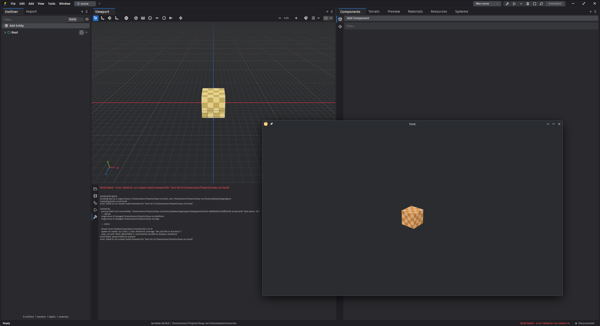

> [!IMPORTANT]
> In development, WIP.

# Bevy-Roc

Roc language bindings for Bevy Game Engine.

## About

Lets you use use roc to write bevy game logic, while Bevy handles processing game entities & rendering. And Jackdaw handles scene editing & development tooling.



## Workflow

Jackdaw editor owns the build process, so we can have full intergration.

```
Jackdaw Build / Play
        │
        ▼
cargo build -p roc-bevy-host
        │
        ▼
host/build.rs  → roc build →  target/roc/libapp.a
        │
        ▼
rustc links Bevy host + libapp.a
        │
        ▼
Play runs that binary (IPC + maybe_windowless)
```

Install Jackdaw, rustup, rust, roc & zig:
```sh
nix run github:lukewilliamboswell/roc-blueprint/0.11.0 -- shell
```

New Jackdaw project:
```sh
jd new host
```

...
```sh
nix run github:lukewilliamboswell/roc-blueprint/0.11.0 -- run rustup-default
nix run github:lukewilliamboswell/roc-blueprint/0.11.0 -- run jackdaw-import

# edit host to add GamePlugin + JackdawPlugin as above
nix run github:lukewilliamboswell/roc-blueprint/0.11.0 -- run jackdaw-doctor

# Building the rust host for the first time will take awhile...
nix run github:lukewilliamboswell/roc-blueprint/0.11.0 -- run jackdaw-build

# Open the editor...
nix run github:lukewilliamboswell/roc-blueprint/0.11.0 -- run jackdaw-open
```
